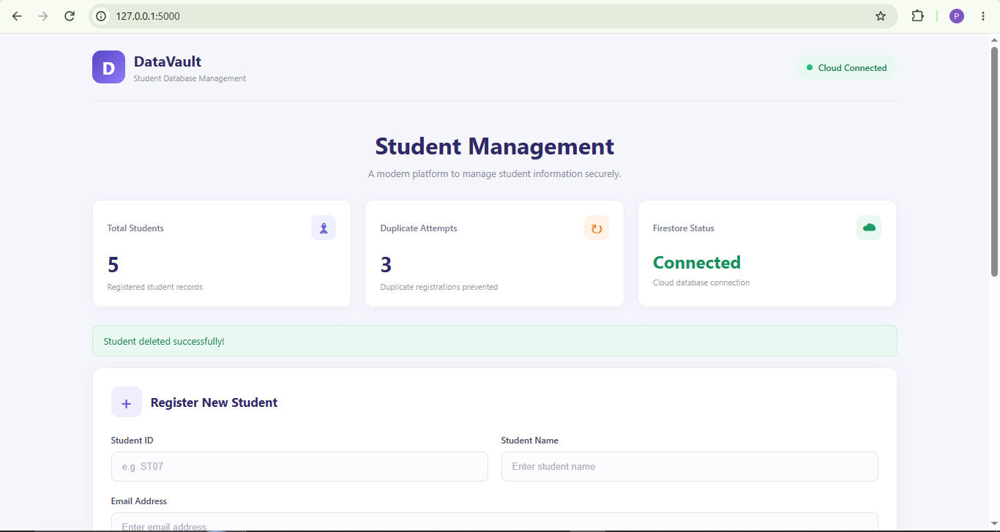
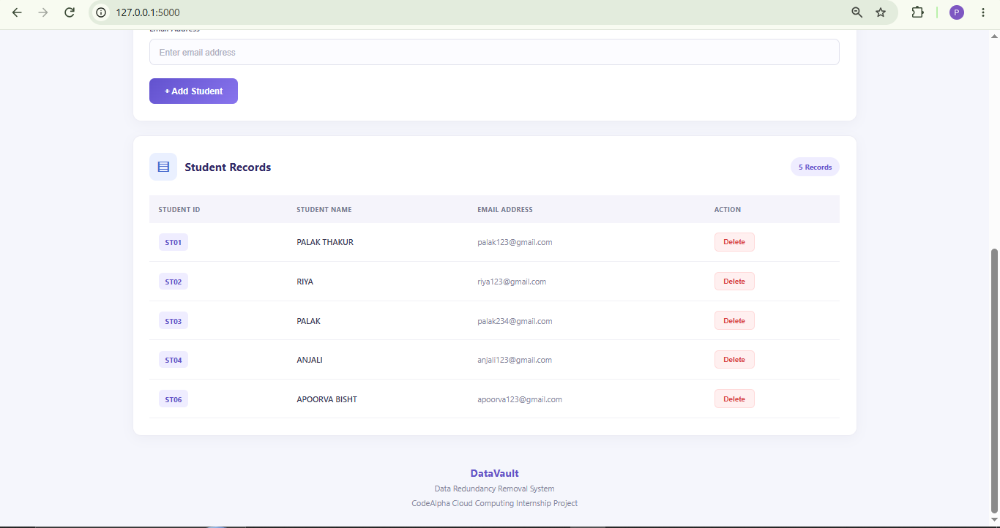
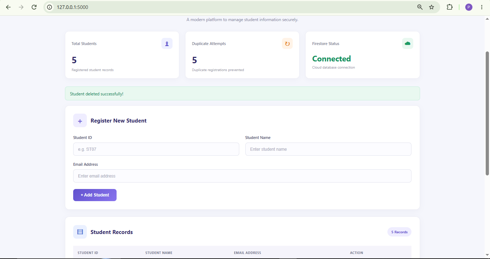
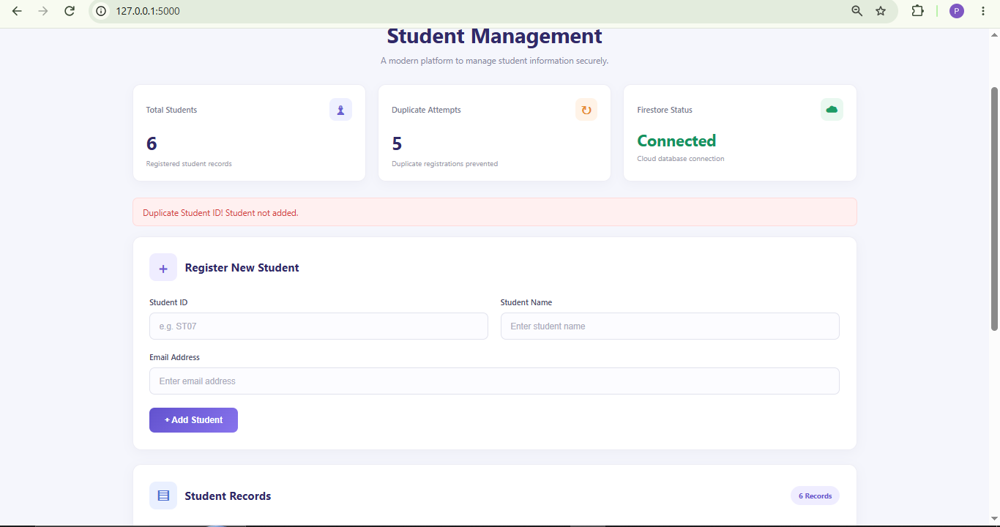
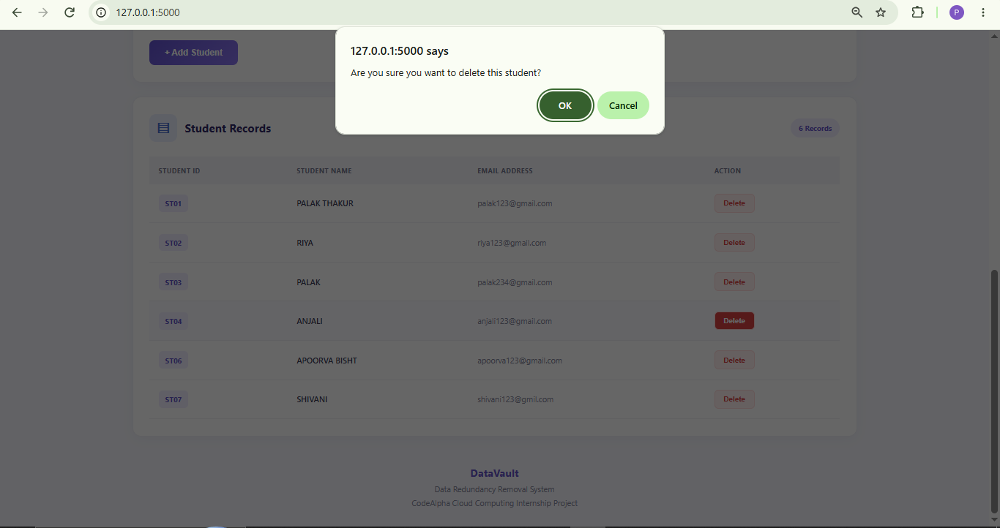

# DataVault – Data Redundancy Removal System

A cloud-based Student Database Management System developed using Python, Flask, and Firebase Firestore as part of the CodeAlpha Cloud Computing Internship.

## Project Overview

DataVault is designed to manage student records efficiently using a cloud-hosted database. It helps prevent duplicate student entries by validating student IDs and email addresses before storing records.

## Features

- Add new student records
- View student records stored in Firebase Firestore
- Delete student records
- Prevent duplicate student IDs
- Prevent duplicate email addresses
- Track duplicate registration attempts
- Display Firebase connection status

## Technologies Used

- Python
- Flask
- Firebase Firestore
- HTML5
- CSS3
- Firebase Admin SDK

## Project Structure

```text
CodeAlpha_DataRedundancyRemoval/
│
├── app.py
├── database.py
├── firebase_config.py
├── test_firebase.py
├── requirements.txt
├── .gitignore
│
├── static/
│   └── style.css
│
└── templates/
    └── index.html
```

## Installation and Setup

### 1. Clone the repository

```bash
git clone https://github.com/PalakTh10/CodeAlpha_DataRedundancyRemoval.git
```

### 2. Open the project folder

```bash
cd CodeAlpha_DataRedundancyRemoval
```

### 3. Install dependencies

```bash
pip install -r requirements.txt
```

### 4. Configure Firebase

- Create a Firebase project.
- Enable Cloud Firestore.
- Generate a Firebase Admin SDK service account key.
- Save the JSON file in the project folder.
- Update the credential filename in `firebase_config.py`.

**Security:** Never upload your Firebase service account JSON file to GitHub.

### 5. Run the application

```bash
python app.py
```

### 6. Open in browser

```text
http://127.0.0.1:5000
```

## Internship

Developed as part of the CodeAlpha Cloud Computing Internship.

## Author

Palak Thakur

GitHub: https://github.com/PalakTh10


## Project Screenshots

### Main Dashboard


### Dashboard – Student Records


### Add Student


### Duplicate Prevention


### Delete Student

